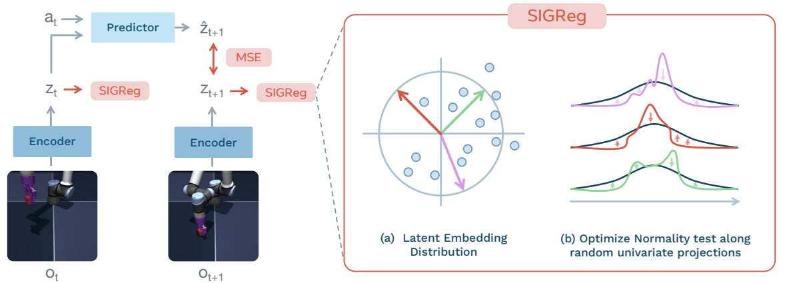
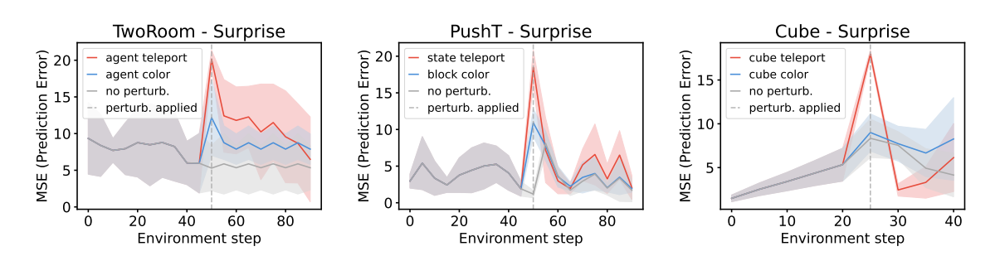

# LeWorldModel 论文阅读笔记

LeWorldModel: Stable End-to-End Joint-Embedding Predictive Architecture from Pixels

作者 Lucas Maes、Quentin Le Lidec、Damien Scieur、Yann LeCun、Randall Balestriero  
版本 arXiv:2603.19312v3，2026年6月3日，预印本，28页  
主题 动作条件潜在世界模型、JEPA、抗表征坍塌、目标条件规划

## 一 核心结论与问题定位

**核心结论：**LeWorldModel（LeWM）的价值，是把从像素端到端学习可规划表征的训练目标简化为两项：下一时刻表征预测误差，以及推动表征分布接近各向同性高斯的 SIGReg。约1500万参数的模型在论文测试的若干连续控制环境中取得有竞争力的成功率，并显著降低规划成本；它还不是经过真实机器人、长时任务或开放世界验证的通用物理模型。

### 研究问题

只要求“预测出的未来表征等于真实未来表征”，会出现一个无用的最优解：所有图像都被编码成同一个常量，预测器也始终输出这个常量。预测误差虽然很低，位置、姿态和动作后果却全部丢失。论文要解决的是：在编码器和预测器共同训练、无需预训练视觉骨干的条件下，如何避免这种坍塌，并让所得表征能够支持控制。\[第2、4—5页\]

### 它在世界模型路线中的位置

| **路线或方法** | **表征与预测方式** | **与本篇的关系** |
| --- | --- | --- |
| I-JEPA 与 V-JEPA | 在表征空间完成自监督预测 | 提供 JEPA 思路；具体训练任务与动作规划设定需区分 |
| DINO-WM | 冻结预训练 DINOv2，再学习动力学 | 借助预训练表征避免坍塌；视觉先验强，但规划表征成本高 |
| PLDM | 编码器与动力学联合训练，多项正则 | 最接近的端到端基线；论文所用目标含7项损失和6个系数 |
| LeJEPA 与 LeWM | 前者提供 SIGReg；后者用于动态预测 | 本篇不是重新发明 SIGReg，而是将其纳入可规划世界模型 |

阅读判断：最值得学习的是“预测任务与表征分布约束如何分工”，以及这套简化目标能否在低成本模型上支持动作规划。作者的“首次”等定位应理解为其论文声明，不能直接当作穷尽文献后的优先权结论。\[第3、11页文献25\]

## 二 模型结构与预测目标

输入是离线收集的图像与动作轨迹。世界模型训练不使用奖励、任务目标或物理状态标注，但需要与图像对应的动作标签。测试时再给定目标图像，通过规划寻找能够到达目标的动作序列。\[第4页\]

图1 预测误差与 SIGReg 的分工 摘自原文图1 第1页

### 编码器与动作条件预测器

编码器使用 ViT-Tiny：12层、3个注意力头、隐藏维度192、patch大小14，约500万参数。最后一层的 \[CLS\] 表征经过带 BatchNorm 的单层 MLP 投影。作者指出，ViT 末端的 LayerNorm 会约束输出分布，使抗坍塌目标难以有效优化，因此需要投影步骤。\[第4页\]

预测器约1000万参数，采用6层 Transformer、16个注意力头和0.1 dropout。动作通过每层的自适应层归一化 AdaLN 注入，相关参数从零初始化。预测器读取有限长度的历史表征，使用因果掩码避免看到未来；其输出也经过投影网络。Push-T 与 OGBench-Cube 默认读取3帧历史，TwoRoom 为1帧。\[第4—5、18页\]

### 预测目标与退化解

训练采用 teacher forcing：用真实历史帧的编码表征预测下一帧表征，再在样本与时间上汇总误差。真实目标表征和预测表征两侧均参与梯度传播；没有额外的停止梯度分支或 EMA 教师编码器。\[第5页式1与第17页算法3\]

如果所有输入都映射为常量 c，预测器也输出 c，预测损失同样可以为零。因此，“预测准确”本身不足以证明学到了有用状态。SIGReg 的作用是排除这类没有样本差异的表征分布，而预测项负责让表征与环境动态有关。

## 三 SIGReg 的机制与理论边界

### 将高维分布匹配化为一维检验

SIGReg 的全称是 Sketched-Isotropic-Gaussian Regularizer。它约束的是一批样本的表征分布，而不是让每张图像都随机生成一个高斯变量。LeWM 的编码和动力学预测仍是确定性映射，不能将其直接理解为 VAE 的概率后验。\[第5、13页\]

第一步，从单位超球面随机抽取 M 个方向，将高维表征投影到每个方向上。第二步，使用 Epps–Pulley 统计量衡量每个一维投影分布与标准正态分布的差异。第三步，对各方向的统计量取平均，得到可反向传播的分布匹配损失。

Epps–Pulley 检验在特征函数空间衡量经验分布与目标高斯分布的差异。直观上，它要求表征不仅不能全挤在一个点上，还应在不同方向上保持适当的分布形状。各向同性高斯的目标协方差为单位阵，因此常量表征明显无法满足约束。\[第13页附录A\]

### 完整目标与实现方式

默认采用 M＝1024 个随机投影方向，正则权重 λ＝0.1。算法按时间步对批内样本的表征施加 SIGReg，再对时间步取平均；不直接要求相邻时间步彼此分散。这一点与后文观察到的潜在轨迹逐渐变直有关。\[第5、17、26页\]

两项损失存在明确的权衡：预测项偏好容易预测的状态因素，分布项维持样本间差异。正则过弱不能充分抑制退化，过强则可能让分布匹配压过动力学建模。Push-T 消融中 λ＝0.5 的表现明显下降。\[第25页图16\]

### 阅读时应保留的三个限定

一是抗坍塌不等于物理语义保证。Cramér–Wold 定理支持“全部一维投影匹配可以确定联合分布”；论文的分布收敛表述涉及投影数的渐近情形。有限投影、有限批量和实际神经网络优化，不能因此获得全局收敛或完整物理理解的保证。\[第13页\]

二是“一个超参数”指主要需要调节的损失权重，并不意味着系统没有表示维度、模型规模、dropout、历史长度和规划预算等选择。后续消融表明，其中一些因素会显著影响成功率。

**三是**作者提出用二分式搜索降低调参成本，但文中结果不构成性能关于 λ 单调或全局单峰的证明。可借鉴的是搜索空间显著缩小，而非将对数搜索复杂度当作任何任务都适用的保证。

## 四 潜在空间规划与复现要点

### 目标图像如何变为动作

训练完成后冻结世界模型。将当前图像和目标图像编码为当前表征与目标表征；对每条候选动作序列，在潜在空间中自回归预测未来状态，再按终点表征与目标表征之间的平方距离打分。\[第5—6页式4—5、图4\]

交叉熵方法 CEM 的循环是：从动作分布中采样候选序列，使用世界模型评估代价，保留代价最低的一组精英样本，再用其均值和方差更新采样分布。它不要求对动作计算梯度，但也不保证全局最优；动作序列越长、维数越高，搜索越困难。\[第13—14页附录B\]

MPC 用新观测重新规划，以控制模型滚动误差。这里需要读清实验细节：正文描述一般形式的“执行前 K 步再规划”；附录D的具体配置则执行整个5步计划后再规划，并非每个环境原始时间步都重新求解。\[第6、18页\]

### 关键配置

| **项目** | **论文设置** | **复现时的含义** |
| --- | --- | --- |
| 图像与批量 | 224×224；batch size 128 | 编码器训练来自任务环境的像素数据 |
| 训练片段 | 4帧；frame-skip＝5 | 每个模型动作块对应5个连续环境动作 |
| 表征与正则 | 192维；M＝1024；λ＝0.1 | 默认起点，仍应监控表征分布与预测误差 |
| 规划跨度 | H＝5个模型步 | 对应25个环境时间步 |
| CEM 采样 | 每轮300条，保留30条精英 | 初始采样方差为1 |
| CEM 迭代 | Push-T 最多30轮；其余10轮 | 不能把附录B的通用30轮描述套到所有任务 |
| 执行与训练 | 执行5个模型步后重规划；10 epochs | 同一组主要超参数用于不同环境的分别训练 |

来源：第17—18页附录D、附录E。论文在摘要中报告单GPU、数小时训练；该表不能替代完整的硬件、优化器和代码配置记录。

### 我对规划目标的理解

LeWM 希望让表征既能预测未来，也让“离目标更近”在潜在空间中有意义。但高斯分布匹配并不直接证明欧氏距离就是任务代价，终点接近也未必意味着沿途安全。迁移到有碰撞约束、部分可观测或高风险的任务时，需要单独检验路径质量和约束满足情况。

## 五 控制实验与效率结果

### 实验覆盖范围

模型分别在四个模拟环境中训练和评估。TwoRoom 是穿门导航，Push-T 是二维接触推动，OGBench-Cube 是三维机械臂搬运单个方块，Reacher 是双关节机械臂到达目标配置。数据规模分别为1万、2万、1万和1万条轨迹，均训练10个 epoch。\[第18页附录E\]

评估目标从离线轨迹中选择：随机取起始状态，再取同轨迹25个时间步后的状态作为目标，最多允许执行50步。由此确保目标在数据动力学中可达，但不能据此推断陌生目标组合或分布外场景的规划能力。\[第19页附录F.1\]

### 主图中的成功率

| **环境** | **LeWM** | **PLDM** | **DINO-WM** | **DINO-WM 加本体感知** |
| --- | --- | --- | --- | --- |
| TwoRoom | 87% | 97% | 100% | 100% |
| Reacher | 86% | 78% | 79% | 未报告 |
| Push-T | 96% | 78% | 74% | 92% |
| OGBench-Cube | 74% | 65% | 86% | 未报告 |

来源：第7页图6柱上标值；此处未抄录图中误差线。默认 DINO-WM 去掉本体感知输入；加本体感知版本单独列出。Push-T 相对 PLDM 提升18个百分点，而非把相对增幅与百分点混用。

结果呈现清晰的取舍：LeWM 在 Push-T 和 Reacher 上更强，在 OGBench-Cube 上仍落后于 DINO-WM，在最简单的 TwoRoom 上也不是最优。作者认为低维、低多样性数据可能与高维高斯先验不匹配；这是解释假设，尚不是被完全隔离验证的原因。\[第7页\]

### 如何理解最高48倍加速

第3页图3报告完整规划时间约为 DINO-WM 的47秒与 LeWM 的0.98秒，平均于50次运行。紧凑表征所需 token 约少两个数量级，是速度优势的重要来源。同一 FLOPs 预算下，图中 Push-T 成功率为90%对13%，OGBench-Cube 为74%对48%。这是固定算力预算的另一组评估，不能与上表直接混为同一协议。

阅读判断：速度优势支持“更小的规划状态降低搜索成本”，但不代表所有硬件、候选数和时域都能得到48倍提升；0.98秒也不能直接解释为高频机器人控制已经解决。

结果核对提醒：附录表5的多种子 Push-T 结果是 LeWM 96.0±2.83、PLDM 78.0±5.0、DINO-WM 92.0±1.63。表5没有像图6一样标注 DINO-WM 的本体感知条件，且与图6默认 DINO-WM 的74%不同。复现时应核对配置，不将两个数字当成同一设定。

## 六 物理理解证据应该如何解读

### 物理量探针说明表征保留了什么

作者冻结表征，额外训练线性或 MLP 探针，预测位置、角度等物理量。线性探针检验信息是否容易直接读出，MLP 检验非线性变换后是否可读出。这里使用物理状态监督的是诊断探针，不是 LeWM 的世界模型训练。\[第8、20—21页\]

| **Push-T 物理量** | **LeWM 线性相关系数 r** | **PLDM 线性 r** | **DINO-WM 线性 r** |
| --- | --- | --- | --- |
| 智能体位置 | 0.974 | 0.955 | 0.977 |
| 方块位置 | 0.986 | 0.938 | 0.997 |
| 方块角度 | 0.902 | 0.745 | 0.979 |

来源：第8页表1；r 越高越好。LeWM 对上述物理量优于 PLDM，但不能据此宣称胜过预训练视觉表征。三维环境中，速度和旋转量尤其困难，例如末端 yaw 的 MLP r 为 LeWM 0.213、DINO-WM 0.917。\[第21页表4\]

### 违反预期实验说明模型对什么敏感

作者比较正常轨迹、物体突然变色和物体瞬移三类情况，以预测表征与实际未来表征的差异衡量 surprise。LeWM 在 TwoRoom、Push-T 和 OGBench-Cube 的瞬移事件上出现显著 surprise 增长，配对 t 检验 p＜0.01；颜色变化引发的增长较弱且不显著。\[第9页图8、第21—23页\]

图2 正常轨迹 变色与瞬移的 surprise 对照 摘自原文图8 第9页

阅读判断：这个结果支持模型对所测试的空间连续性破坏更敏感，不能单独证明它理解了质量、力、守恒或因果机制。瞬移也构成分布外变化，应继续使用力度、摩擦、遮挡等更细致干预来排除简单异常检测的解释。

### 解码与轨迹几何提供辅助证据

另行训练的解码器能够从低维表征恢复场景与大体运动，但三维末端朝向等细节会丢失；解码器不参与世界模型的重构训练。潜在轨迹在训练中变得更直，是没有显式时间平滑损失时出现的观察结果，其成因和对规划的因果贡献仍需专门消融。\[第8、18—20、26—27页\]

## 七 消融结果与论文局限

### 哪些设计确实影响效果

| **Push-T 消融** | **论文报告的成功率** | **可支持的解释** |
| --- | --- | --- |
| 加入重构损失 | 不加96.0±2.83；加入86.0±7.54 | 本实验中像素重构目标没有改善控制 |
| 编码器架构 | ViT 96.0±2.83；ResNet-18 94.0±3.27 | 方法不限于一种编码器，仍有架构差异 |
| 预测器 dropout | 0时78±6.54；0.1时96.0±2.83 | 两项损失不意味着其他设计不重要 |
| 预测器规模 | tiny 80.67；small 96.0；base 86.7 | 增加容量不保证单调改善 |
| 规划求解器 | CEM 96.0±2.83；Adam 84±7.12 | 规划器同样影响最终控制结果 |
| 正则权重与投影数 | λ在0.01—0.2表现较稳；投影数不敏感 | 该任务中损失调参更简单，但不能推广为任意任务免调参 |

来源：第24—26页图15—16、表6—10。百分数和误差项按原文保留；预测器规模行仅列均值。这里的消融主要来自 Push-T，不是每个环境都完整验证了每项设计。

### 作者承认的局限

规划以短时域为主，长时推理仍需层次化世界模型；离线数据需要覆盖足够的动力学，低多样性数据会削弱正则作用；当前依赖动作标签，作者将大规模视频预训练和逆动力学作为未来方向。\[第9页\]

### 进一步需要验证的边界

泛化边界：四个模拟环境展示了任务多样性，但不是同一个模型跨环境通用，更没有完成真实机器人、多智能体交互、动态重建或开放世界验证。数据内可达目标的结果不能替代跨场景、跨物体和跨任务测试。

表征与决策的边界：TwoRoom 的位置探针很好，却仍存在规划性能差距，说明“状态可读出”并不足以保证动力学与潜在代价适合决策。高斯分布约束也不能自动保证保留所有任务相关信息。\[第20页表3\]

不确定性边界：本文主要以确定性表征滚动与终点距离规划，未系统解决多模态未来、模型置信度、探索风险或安全约束。长时滚动容易累积误差，模型也可能为数据覆盖不足的动作给出看似合理的预测。

我的总体评价：这是一套值得复现的简洁基线。最有说服力的是降低训练目标复杂度后仍能完成规划；最需要谨慎的是从“没有坍塌、探针表现好”跨越到“已经理解通用物理”的推断。

## 八 可验证的研究启发与复习提纲

### 对后续研究的启发

第一，把任务约束与分布约束分开设计。预测任务决定表征应保留哪些动态信息，SIGReg 决定样本表征不能退化为常量。若要扩展到协作感知或三维时空表示，仍需明确新任务真正要预测的状态，以及这些状态是否能够被当前观测识别。

第二，优先检验潜在距离是否适合任务。一个表征可能非常容易读出位置，却让终点距离、接触关系或可达性失真。可以同时报告物理量探针、动作条件预测误差、潜在距离与实际任务代价的相关性，而不是只展示重构图片或成功率。

第三，紧凑表征的效率收益要与信息损失一起衡量。单个全局 token 有利于规划，但可能丢失小物体、朝向和局部接触。全局与对象级表征的组合值得测试；是否能够改善协作建模或主动观测，应由新实验回答，本文尚未验证这些扩展。

### 一个可以实际开展的最小实验

问题：低维环境中的性能下降，主要来自高斯先验与状态维度不匹配，还是来自动力学预测与规划目标？这是对作者 TwoRoom 解释的一项验证方案，并非论文已经完成的实验。

固定 TwoRoom 数据划分、训练预算、预测器与 CEM 预算，仅改变表征维度和 λ，至少使用3个训练种子。并行记录位置探针、一步与多步预测误差、表征有效维度以及规划成功率。若降低维度能在不损害状态探针的情况下改善规划，再逐步检查潜在距离与跨门可达性的关系。

判断标准：若探针几乎不变而规划改善，应进一步定位动力学与代价几何；若低维配置同时改善分布匹配与规划，则更支持先验维度不匹配的解释。也应保留“降低维度导致关键信息丢失”的反例，避免只挑支持假设的结果。

### 复习时应能独立回答

为什么下一表征预测会出现常量解？SIGReg 约束的是单样本还是批内分布？为什么不使用重构损失仍可能保留场景信息？训练时的 teacher forcing 与规划时自回归滚动有何差别？48倍加速对应什么实验条件？为什么 probe、surprise 和规划成功率需要分别报告？

### 原文定位与资料入口

方法与公式：第4—6页；SIGReg 推导：第13页；训练伪代码：第17页；具体实现和数据：第17—19页；控制结果：图3、图6与表5；物理探针和 VoE：第8—9、20—23页；消融和训练曲线：第24—28页。

论文版本 https://arxiv.org/abs/2603.19312v3  
项目主页 https://le-wm.github.io  
作者代码 https://github.com/lucas-maes/le-wm

关键词 JEPA 联合嵌入预测架构；representation collapse 表征坍塌；isotropic Gaussian 各向同性高斯；CEM 交叉熵方法；MPC 模型预测控制；VoE 违反预期。

## 参考来源

- https://arxiv.org/abs/2603.19312v3 <kbd>AI</kbd>
- 2026 <kbd>AI</kbd>
- arXiv <kbd>AI</kbd>
- https://arxiv.org/pdf/2603.19312v3 <kbd>AI</kbd>

- LeWorldModel: Stable End-to-End Joint-Embedding Predictive Architecture from Pixels：https://arxiv.org/abs/2603.19312v3
